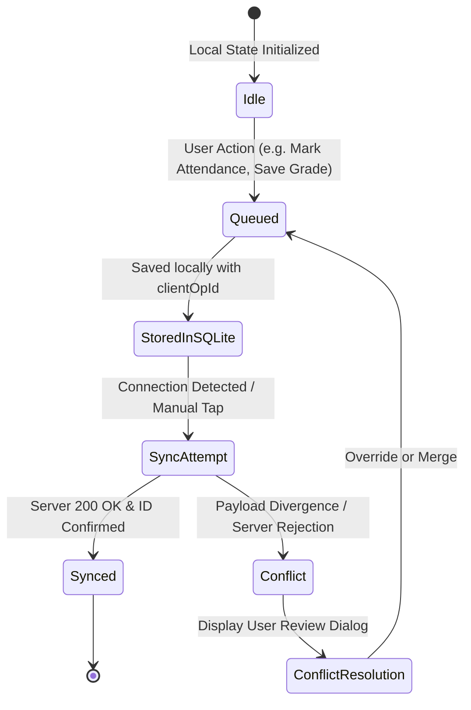

# AgriProvider Figma UI/UX Design Specification

**Version:** 1.0  
**Target Platform:** Mobile (iOS / Android - React Native & Expo SDK 58), Tablet & Responsive Web / PWA  
**Primary Locale:** South Africa (SAST UTC+02:00, South African ID validation, +27 mobile formats)  
**Design Reference:** `docs/assets/figma-design.png`

---

## 1. Executive Summary & Design Vision

AgriProvider is a mission-critical, offline-first agricultural training, accreditation, and evidence verification mobile application designed specifically for South African agricultural training providers, assessors, quality assurance (QA) officers, administrators, and rural learners.

### Key Design Tenets
1. **Field-Ready & Outdoor Optimized:** High contrast ratios (WCAG 2.1 AA compliant, minimum 4.5:1 for normal text, 7:1 for headers), generous 48x48px touch targets, and sunlight-readable typography designed for farm and rural training center environments.
2. **Offline-First Clarity:** Explicit network and sync indicators. Actions taken offline (attendance, grading, document queuing) are clearly badged with a pending status so field officers never doubt whether their work is preserved.
3. **Role-Driven Simplicity:** 5 specialized portal experiences (Learner, Training Provider, Assessor, QA Officer, Admin) each tailored to specific daily jobs without unnecessary feature clutter.
4. **South African Localization:** Built-in South African 13-digit National ID validation (Luhn checksum + citizenship checks), provincial selectors across all 9 provinces, +27 phone formatting, and SAST (UTC+02:00) date and time display.

---

## 2. Visual Identity & Design System (Tokens)

### 2.1 Color Palette

```
/* Primary Brand - Agricultural Greens */
--brand-primary:        #164c38;   /* Deep Forest Green - Main headers, primary buttons */
--brand-primary-hover:  #1e6b4f;   /* Medium Forest - Hover and active states */
--brand-secondary:      #2e9e73;   /* Emerald Green - Highlights, success badges */
--brand-surface-light:  #e0eee6;   /* Pale Sage - Table headers, tag backgrounds */
--brand-bg-subtle:      #f4f8f5;   /* Off-white sage - Screen backgrounds */

/* Functional Accents */
--status-success:       #16a34a;   /* Verified, Approved, Competent */
--status-warning:       #d97706;   /* Pending Review, Offline, Changes Requested */
--status-error:         #dc2626;   /* Rejected, Overdue, Validation error */
--status-info:          #2563eb;   /* Informational banners, in-progress sync */

/* Neutrals & Text */
--text-main:            #0f172a;   /* Slate 900 - Primary body and headings */
--text-muted:           #475569;   /* Slate 600 - Secondary captions, labels */
--border-subtle:        #cbd5e1;   /* Slate 300 - Input borders, card dividers */
--surface-white:        #ffffff;   /* Pure white - Card and modal backgrounds */
```

### 2.2 Typography Scale (Inter / System Sans-Serif)

| Token | Size | Weight | Line Height | Purpose |
|---|---|---|---|---|
| `Display / H1` | 26px / 1.625rem | Bold (700) | 32px | Screen titles, key portal headings |
| `Heading / H2` | 20px / 1.25rem | SemiBold (600) | 26px | Section titles, card group headers |
| `Heading / H3` | 16px / 1.0rem | SemiBold (600) | 22px | Card titles, modal headers |
| `Body Large` | 15px / 0.9375rem | Regular (400) | 22px | Primary text, form inputs, button labels |
| `Body Medium` | 14px / 0.875rem | Regular (400) | 20px | Secondary descriptions, list item details |
| `Caption / Badge` | 12px / 0.75rem | Medium (500) | 16px | Status tags, timestamps, sync indicators |

### 2.3 Spacing, Elevation & Corner Radius
- **Base Grid:** 4px baseline, 8px standard module.
- **Card Padding:** 16px on mobile viewports; 20px on tablet/desktop.
- **Corner Radii:**
  - Small elements (Tags, badges): `6px`
  - Form controls (Inputs, primary buttons): `10px`
  - Cards & Content containers: `14px`
  - Bottom sheet dialogs / Modals: `20px` top radius
- **Elevation / Shadows:**
  - Level 1 (Cards, list items): `0 1px 3px rgba(0, 0, 0, 0.08)`
  - Level 2 (Floating buttons, sync pill): `0 4px 12px rgba(22, 76, 56, 0.15)`
  - Level 3 (Modals, bottom sheets): `0 10px 25px rgba(0, 0, 0, 0.2)`

---

## 3. Information Architecture & Navigation Structure

```mermaid
flowchart TD
    A[App Entry / Splash] --> B{Authenticated?}
    B -->|No| C[Auth Portal: Login / Signup / Reset / MFA Challenge]
    B -->|Yes - Check Role| D[Role Router]
    
    D -->|LEARNER| L[Learner Portal]
    L --> L1[My Courses]
    L --> L2[Lesson Schedule & Attendance]
    L --> L3[Assessment Results]
    L --> L4[Private Document Uploads]
    L --> L5[Verified Certificate Records]

    D -->|PROVIDER| P[Provider Portal]
    P --> P1[Cohort & Programme Manager]
    P --> P2[Learner Enrolment & SA ID Validation]
    P --> P3[Attendance Register]
    P --> P4[Individual Learner Evidence Packs]
    P --> P5[Assessor Submission & Sync Queue]

    D -->|ASSESSOR| AS[Assessor Portal]
    AS --> AS1[Assigned Cohort Queue]
    AS --> AS2[Learner Grading Matrix]
    AS --> AS3[Generate Individual Reports]
    AS --> AS4[Forward Complete Packs to QA]

    D -->|QA_OFFICER| QA[QA Officer Portal]
    QA --> QA1[Cohort Audits & Checklists]
    QA --> QA2[Individual Learner Pack Verification]
    QA --> QA3[Findings & Request Re-upload]
    QA --> QA4[Unlock Milestones / Certification Sign-off]

    D -->|ADMIN| AD[Administrator Portal]
    AD --> AD1[Staff Application Review & Approval]
    AD --> AD2[Provider Accreditation Dates]
    AD --> AD3[Assessor Assignment]
    AD --> AD4[MFA & Audit Logs]
```



---

## 4. Screen-by-Screen UI/UX Specifications

### 4.1 Authentication & Onboarding Screens

1. **Sign In (`apps/mobile/src/app/(auth)/login.tsx`)**
   - Clean, green-accented card layout with AgriProvider logo.
   - Email and password inputs with field-level inline validation.
   - Links to "Create account" and "Forgot password".
   - Seamless transition for users requiring MFA: opens instant single-use TOTP challenge modal without issuing session tokens.

2. **Sign Up & Account Request (`apps/mobile/src/app/(auth)/signup.tsx`)**
   - Role selection toggle: *Training Provider*, *Assessor*, or *QA Officer* (Administrators and Learners cannot self-register).
   - Province selector (Eastern Cape, Free State, Gauteng, KwaZulu-Natal, Limpopo, Mpumalanga, Northern Cape, North West, Western Cape).
   - South African phone number input with `+27` prefix validation.
   - Clear post-submission state: redirects to **Awaiting Administrator Approval** screen with explanation that accreditation and credentials will be audited by the Admin team before login is enabled.

3. **Admin Mandatory MFA Setup (`apps/mobile/src/components/MfaSetup.tsx`)**
   - Displays locally generated TOTP QR code and 16-character secret key (`JBSWY3DPEHPK3PXP` for demo).
   - 6-digit numeric verification input.
   - Generates and presents 8 one-time emergency recovery codes in copyable text boxes.

---

### 4.2 Training Provider Portal

1. **Dashboard & Programme Management**
   - Active cohorts overview card with status badges (`Enrolling`, `In Progress`, `Assessor Review`, `QA Review`, `Completed`).
   - Quick action pills: `+ New Cohort`, `Mark Attendance`, `Sync (3 pending)`.
   - SAST-enabled calendar view displaying upcoming module dates.

2. **Learner Enrolment & SA ID Verification**
   - Multi-field enrolment form: Full Name, 13-digit National ID Number, Gender, Date of Birth, Phone, Email, Physical Address.
   - Real-time client-side Luhn verification: shows instant green checkmark when ID is valid; informs user if checksum fails.
   - Cohort capacity meter (e.g., `5 / 6 Enrolled` - remaining slot highlighted).

3. **Daily Lesson Attendance**
   - List of enrolled learners with large, outdoor-friendly radio buttons: `[ P ] Present`, `[ A ] Absent`, `[ E ] Excused`.
   - "Mark All Present" batch helper with individual override capability.
   - Offline queue integration: Saving offline immediately turns sync badge yellow (`Pending sync`), allowing full operations without internet connectivity.

4. **Individual Learner Evidence Packs (`apps/mobile/src/components/LearnerPacks.tsx`)**
   - Dedicated tabbed view per learner.
   - Document checklist categories:
     - Identification (Certified ID Copy)
     - Enrolment & Learner Agreement
     - Formative Assessments & Logbooks
     - Signed Competency Certificate
   - Versioned upload history: earlier files remain accessible; new uploads append rather than overwrite.
   - "Submit Pack to Assessor" button with validation check for required documents.

---

### 4.3 Assessor Portal

1. **Assigned Cohorts & Grading Queue**
   - Displays cohorts specifically assigned to the logged-in assessor by Admin.
   - Progress bar showing percentage of learner packs graded.
2. **Grading Matrix & Outcome Submission**
   - Per-learner scorecard with module outcomes: *Competent (C)* or *Not Yet Competent (NYC)*.
   - Score input (0-100%) and assessor notes text field.
   - Automatic generation of individual PDF/data assessment report upon submission.
   - "Forward Learner to QA" action triggers when assessment report and passing results are recorded.

---

### 4.4 QA Officer & Moderation Portal

1. **Cohort Audit & Verification Checklist**
   - Overview of cohort compliance metrics: attendance threshold (>80%), complete learner packs, signed assessor reports.
2. **Pack Audit & Findings Flow**
   - Document preview viewer with zoom and rotation.
   - "Approve Pack" vs "Request Re-Upload / Changes" actions.
   - Correction dialogue enforces mandatory, non-blank audit feedback (e.g., *"ID document copy is blurry; please re-upload clear photo of front and back"*).
3. **Milestone Unlock & Certification Sign-Off**
   - Visual toggle verifying independent moderation slot is signed off.
   - "Unlock Milestone" button changes milestone state from `READY_FOR_REVIEW` to `UNLOCKED`.
   - Does NOT process payments; updates audit record and releases private certification records to passing learners.

---

### 4.5 Learner Portal

1. **My Courses & Lessons**
   - Friendly greeting with learner's name and enrolled programme.
   - Next upcoming class date in SAST with module name and venue.
   - Access to provider-published learning materials and PDF guides.
2. **My Attendance & Assessment Results**
   - Personal attendance rate visual circular progress indicator.
   - Detailed breakdown of module outcomes and assessor comments.
3. **Private Documents & Certification**
   - Self-service document uploader for ID and signed consent.
   - Verified digital certificate display with accreditation code once QA has unlocked the milestone.

---

### 4.6 Administrator Portal

1. **Staff Application Approvals (`apps/mobile/src/app/(admin)/pending-accounts.tsx`)**
   - Table of pending provider, assessor, and QA requests.
   - Provider accreditation date verification inputs (Accreditation Number, Issue Date, Expiry Date).
   - One-click "Approve" (activates account and queues welcome email) or "Reject" (prompts for reason and archives).
2. **Assessor-Cohort Assignments**
   - Dual-column selector allowing instant assignment of qualified assessors to specific cohorts.

---

## 5. Offline-First UX & Field Interaction Patterns



### Visual Sync Indicator (Floating Pill)
- **Online (Synced):** Small green dot `[ • Synced ]`
- **Offline (Saved locally):** Amber pill `[ ⚡ Offline (3 saved) ]`
- **Syncing in progress:** Blue animated spinner `[ ↻ Syncing... ]`
- **Sync error / Conflict:** Crimson badge `[ ⚠ Action Required ]`

---

## 6. Accessibility & Field Usability Standards

1. **Sunlight Legibility:** Minimum text size of 14px on mobile, primary text color `#0f172a` against `#ffffff` card surfaces exceeds WCAG AAA contrast ratio (14:1).
2. **Touch Ergonomics:** Form fields have 48px height; buttons have minimum 50px height with 12px vertical spacing between touch targets.
3. **Bandwidth Optimization:** Document pickers automatically compress captured images on device before saving to SQLite and uploading, minimizing cellular data consumption in rural South African provinces.

---

## 7. Mockup Architecture & Asset Reference

The comprehensive visual UI/UX layout has been rendered and preserved in the design pack at `docs/assets/figma-design.png`. An interactive prototype viewer is provided at `docs/figma-prototype.html` for instant cross-device inspection.
