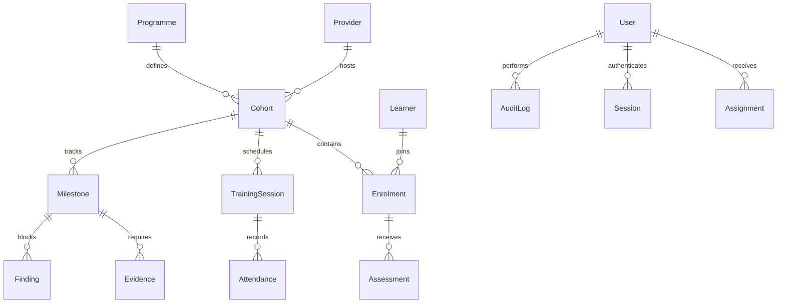

# AgriProvider implementation
User approved restructuring, local services, capacity enforcement and a second assessor on 11 November 2026.
Existing source stays intact under app/ and backend/ until the new workspace is verified. Git history and uncommitted work are preserved.
## Structure
apps/mobile/src/app/(auth|provider|assessor|qa|admin), apps/api/src, packages/shared/src.
Role screens are dedicated. Shared primitives and account-scoped sync are reusable.
## API
/api/v1/auth/{login,refresh,logout,forgot-password,reset-password,accept-invite,mfa}
/api/v1/me
/api/v1/provider/{home,cohorts,learners,attendance,evidence,milestones}
/api/v1/assessor/{home,batches,assessments,moderation,slots}
/api/v1/qa/{audits,findings,milestones}
/api/v1/admin/{dashboard,users,providers,programmes,cohorts,assignments,settings,approvals,integrations,audit-log,data-requests,health}
## Data relationships

## Deployment outline
Render API, static Expo web export, outbox worker and housekeeping cron. Neon pooled application URL and direct migration URL. S3/R2 private evidence storage. No live deployment until external services are configured.
## Verification gates
Shared validation and auth/isolation; admin and configuration; provider/offline; assessor/moderation; QA/milestones; integration/outbox; web build and end-to-end flows. Native device tests require attached devices or the user's phones.
