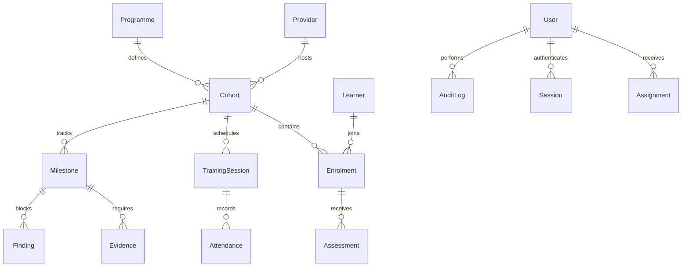
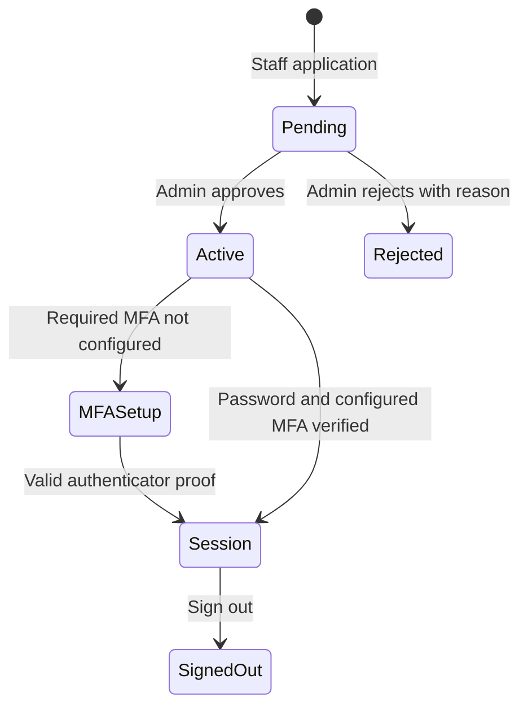

# AgriProvider implementation
User approved restructuring, local services, capacity enforcement and a second assessor on 11 November 2026.
Existing source stays intact under app/ and backend/ until the new workspace is verified. Git history and uncommitted work are preserved.
## Structure
apps/mobile/src/app/(auth|provider|assessor|qa|admin), apps/api/src, packages/shared/src.
Role screens are dedicated. Shared primitives and account-scoped sync are reusable.
## API
/api/v1/auth/{login,refresh,logout,forgot-password,reset-password,accept-invite,mfa}
/api/v1/me
/api/v1/provider/{home,cohorts,learners,attendance,evidence,milestones}
/api/v1/assessor/{home,batches,assessments,moderation,slots}
/api/v1/qa/{audits,findings,milestones}
/api/v1/admin/{dashboard,users,providers,programmes,cohorts,assignments,settings,approvals,integrations,audit-log,data-requests,health}
## Data relationships

## Deployment outline
Render API, static Expo web export, outbox worker and housekeeping cron. Neon pooled application URL and direct migration URL. S3/R2 private evidence storage. No live deployment until external services are configured.
## Verification gates
Shared validation and auth/isolation; admin and configuration; provider/offline; assessor/moderation; QA/milestones; integration/outbox; web build and end-to-end flows. Native device tests require attached devices or the user's phones.

## Five portals and approval onboarding (12 November 2026)
The latest request adds a learner workspace and replaces invite-only staff onboarding with admin-reviewed public applications. Existing authorised accounts are preserved.

1. Add User approval metadata, a unique learner relation, learning materials and lesson titles with an additive migration.
2. Enforce signup -> PENDING -> admin approval/rejection -> ACTIVE; block reset/invitation/session bypasses.
3. Generate local MFA QR images for invitation and login setup; verify a single-use challenge before issuing a session.
4. Let the provider create learner logins, programmes, cohort schedules and materials. Keep learner credentials out of offline storage.
5. Add dedicated learner courses, lessons, attendance and results routes with server-scoped responses.
6. Refine login, navigation, quick actions, evidence tiles, attendance/grade selectors and role dashboards using the retained mockup.
7. Verify API security/workflows, isolated browser journeys, web export and native bundles. Leave production provisioning for the separately configured environment.

### New API routes
- POST /api/v1/auth/signup
- POST /api/v1/auth/mfa/complete
- GET /api/v1/admin/pending-accounts
- POST /api/v1/admin/pending-accounts/:id
- POST /api/v1/provider/learners/:id/account
- POST /api/v1/provider/programmes
- POST /api/v1/provider/cohorts/:id/sessions
- POST /api/v1/provider/cohorts/:id/materials
- GET /api/v1/learner/courses

Learner accounts are provider-created and linked directly to an enrolled learner; they do not use the public staff application flow. Admin accounts are created through administrator invitations/bootstrap.

## Individual learner workflow follow-up — completed locally
- Added private learner document uploads, append-only evidence history and independent provider -> assessor -> QA pack status for every enrolment.
- Moved cohort mutations to provider scope, added account setup/creator emails, SAST calendar fields, country/province selections and country-aware phone checks.
- QA correction requests require a nonblank message and can reopen certification. Development/test certificate uploads accept arbitrary file types with size and scanning checks.
- Applied the non-destructive migration after a database backup. See testing.md for API, browser and bundle validation and remaining external SMTP/device acceptance.
