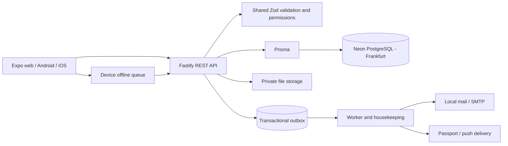

# AgriProvider system documentation

Version 1.0 | 12 November 2026, SAST | implementation baseline `e1144af`

## Purpose and scope

AgriProvider manages accredited training providers, learner enrolment, attendance, assessment, evidence, moderation and quality assurance. Certification and milestone status become available only after the required records pass review. A milestone is a status, not a payment transaction.

The application serves web/PWA, Android and iOS from one Expo/React Native codebase. The backend is a Fastify TypeScript API with Prisma and PostgreSQL. The current web/API processes run locally; the working database is hosted on Neon in AWS Frankfurt. This is a development deployment, not a completed public production service.

## Users and permissions

| User | Main features | Boundaries |
|---|---|---|
| Learner | View own courses, materials, schedule, attendance, results and released certificate records; upload ID, consent and supporting documents | Cannot self-register, grade, approve evidence or see another learner's pack |
| Training provider | Create programmes/cohorts, close/reopen own cohorts, enrol learners, create learner access, record attendance, publish materials, upload individual evidence, submit packs | Own provider only; cannot approve assessment or QA conditions |
| Assessor | View assigned cohorts, grade all learners, obtain per-learner reports, review/forward packs, schedule moderation | Assignment required; grading assessor cannot independently moderate the same cohort |
| QA officer | Audit evidence, verify learner packs and milestone conditions, request corrections, resolve findings, unlock status, recommend suspension | Cannot bypass underlying completeness and accreditation rules |
| Administrator | Approve staff applications, invite/manage users, manage provider accreditation/programmes, assign assessors, review audit/integrations/settings and data requests | Cohorts are read-only; sensitive actions can require a second administrator; MFA required |

## Architecture

Source map: `apps/mobile/src/app` contains role routes, `apps/api/src` contains API/domain/auth/jobs, `packages/shared/src` contains shared validation, and `apps/api/prisma` contains schema/migrations. Legacy prototype folders are not the active product.

Development files are on local disk in `.data/files`; Neon stores relational data and file metadata, not file bytes. Production configuration requires private S3-compatible storage, SMTP and a configured malware scanner. The outbox records work durably for delivery with retries; notifications inside the app are separate from successful email delivery.

## Core workflows

### Account access

Provider, assessor and QA applicants submit public account requests. They remain pending without a session until Admin approves. Provider approval requires reviewed accreditation dates. Administrators are bootstrapped or invited; learners are provisioned by their provider. Invitations and reset links are single-use and expire. Account creation queues a setup/welcome message to the new address and a confirmation to the creator. In local mail mode these are files, not internet email.

Passwords use Argon2id. Login returns a short-lived opaque access token. Web clients use an HTTP-only refresh cookie; native clients receive a refresh token for SecureStore. Refresh rotation detects reuse. Required MFA may return a setup challenge instead of a workspace session; scanning a locally generated QR code or entering its setup key enrolls the authenticator. Recovery codes are one-time alternatives, not reusable passwords.

### Learner evidence and certification

1. Provider creates a programme/cohort and schedules lessons, then enrols learners with consent.
2. Learners upload their own ID, consent or supporting documents. Providers supply the rest of each learner's evidence pack.
3. Provider records attendance and submits each complete initial pack to an assigned assessor.
4. Assessor submits a complete batch of outcomes. The server generates an individual report for each learner. Passing learners require signed certificate evidence; failed learners do not require certificates.
5. Assessor approves and forwards complete individual packs to QA. QA verifies each pack. Independent moderation remains required for final certification.
6. QA verifies enrolment, attendance and certification conditions, resolves linked follow-up findings and unlocks the milestone.
7. Passing learners can see their private certification record; the integration feed exposes unlocked certification events. There is no public QR certificate-verification endpoint in the current API.

Pack states: `DRAFT -> ASSESSOR_REVIEW -> QA_REVIEW -> VERIFIED`; corrections use `CHANGES_REQUESTED`. Milestone states: `LOCKED`, `READY_FOR_REVIEW`, `REJECTED`, `UNLOCKED`, `FROZEN`. Accreditation can freeze work. QA can reject even after unlock when a nonblank reason is supplied. Changes invalidate reviews; upload history remains available. Current enrolment validation requires the cohort to reach its configured capacity, so removing learners can block final verification until enrolment/capacity is corrected through the provider workflow.

### Offline behavior

The PWA caches application assets after an initial online visit. Supported queued operations use a stable `clientOpId` so retries do not duplicate writes. Authorization, capacity and workflow conditions are rechecked on sync. A changed payload with the same operation ID is a conflict. Account creation and credential operations require connectivity. Offline sign-out persists across reopened tabs. Browser offline checks do not establish native background-sync reliability on physical devices.

## Data model

| Area | Entities and relationships |
|---|---|
| Identity | User links to Provider or Learner; AuthSession and OneTimeToken link to User |
| Training | Provider and Programme have Cohorts; Enrolment links Learner to Cohort; TrainingSession belongs to Cohort |
| Learning | Attendance links learner/session; Assessment links learner/cohort/assessor; LearningMaterial belongs to Cohort |
| Review | Milestone belongs to Cohort; Evidence belongs to Milestone and optionally a single learner; LearnerPack links cohort/learner |
| Assurance | ModerationReview, ModerationSlot, Finding and CertificationEvent track review and release |
| Operations | AuditLog, SyncOperation, Notification, OutboxEvent, ApprovalRequest, SystemSetting, ApiKey, DataRequest, SupportGrant and JobHeartbeat |

There are 30 application tables plus Prisma migration history. Foreign keys, uniqueness constraints and domain transactions protect integrity. Identity/phone/MFA values are encrypted; national-ID hashes support duplicate detection and lists expose masked IDs. Role/scope changes and audit mutation are constrained in the database. Keep encryption and token keys when migrating accounts.

## Files, dates and validation

Uploads are multipart, append-only and size limited; current default is 10 MB, configurable up to 20 MB. Genuine PDF/JPG/PNG content is required except certificate uploads in development/test, where arbitrary types are permitted for testing. Malware checks and signature/result requirements still apply. Evidence downloads require authorized scope before generating short-lived links. Production needs a real scanner and private storage configuration.

API date-time inputs use ISO 8601 UTC (`Z`). UI dates/times use SAST (UTC+02:00), for example 09:00 SAST becomes 07:00Z. South African ID validation checks length, date, citizenship and checksum, but is not government identity verification. Account location fields validate country/province/phone combinations. Learner enrolment currently uses South African ID and +27 phone rules.

## Operations and recovery

Use the root README and `deployment.md` for commands. API: port 4000; Expo: 8081; web development: 8082; exported PWA preview: 4173. `/healthz` checks process liveness; `/readyz` checks database connectivity. Launcher logs are under `.data/logs`. Background jobs need a worker or `INLINE_WORKER=true`.

The Neon development branch is `my-new-app` in project `square-paper-75369060` (`aws-eu-central-1`). Runtime uses the pooled URL; migrations use the direct URL. Production branch has schema only. The filtered development migration preserved 11 accounts and four learners, excluded three learners and all 16 evidence records, reset approvals and retained the original local backup. See the private migration report for exact details. These are migration snapshot counts, not permanent system limits.

Before restoring, stop writes, preserve newer records/files, restore a compatible database and matching encryption keys/files, and verify readiness, account scope and file access before reopening traffic. Never restore backups over the only working copy. Keep secret environment files, dumps and uploads out of Git.

## Verification and outstanding work

Historical results in `testing.md`: 53 API/shared cases and 30 browser scenarios passed across full and targeted runs; web and Android/iOS bundle exports passed. These are not a claim that all suites were rerun for this documentation pack. Neon migration verification matched all 30 application tables and checked encrypted fields and service readiness.

Outstanding acceptance: public Render hosting, real SMTP/S3/scanner/integration configuration, signed EAS builds, physical Android/iPhone testing, push delivery, native background behavior and production restore rehearsal. Direct signed resumable uploads remain an enhancement. The project tracker separates these from completed local implementation.
